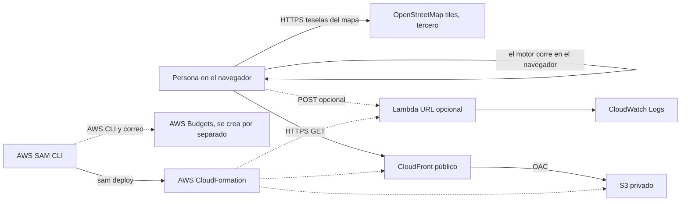

# Arquitectura

La imagen está en [arquitectura.svg](arquitectura.svg). Esta es la fuente.

Región: **us-east-1**.

Público previsto tras el despliegue: la distribución de CloudFront y, si se despliega, la URL de la función. Privado: el bucket y los logs; el presupuesto es visible para el equipo en la consola de costos. El navegador no envía historias clínicas: solo parámetros de escenario.

El mapa base se obtiene desde `tile.openstreetmap.org`, un proveedor externo a AWS. La app muestra la atribución OpenStreetMap y ubica los puntos sintéticos en centros de barrio aproximados, no en domicilios ni casos reales. Requiere internet; la simulación epidemiológica sigue funcionando si falla el proveedor de teselas.

Estado: estos servicios están declarados/preparados en la infraestructura del repositorio, pero no se han desplegado en una cuenta AWS. SAM CLI es la herramienta de despliegue; CloudFormation administra la pila. AWS Budgets se crea fuera de la pila y solo si se proporciona correo mediante `scripts/deploy.ps1 -Email ...`. CloudWatch Logs recibe la salida de Lambda si se usa. Si se habilita la Function URL, el template la configura con `AuthType: NONE`; debe tratarse como endpoint público y no enviar datos personales. El demo principal ejecuta el motor en el navegador y no necesita esa API.
