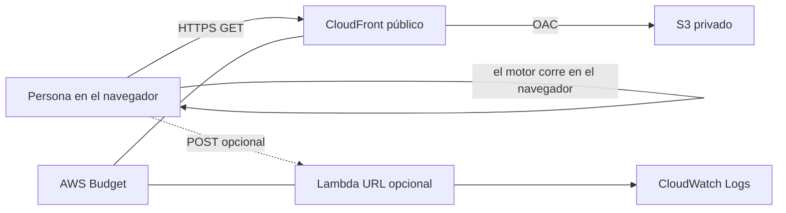

# Arquitectura

La imagen está en [arquitectura.svg](arquitectura.svg). Esta es la fuente.

Región: **us-east-1**.

Público: la distribución de CloudFront y, si se despliega, la URL de la función. Privado: el bucket, los logs y el presupuesto. El navegador no envía historias clínicas: solo parámetros de escenario.
